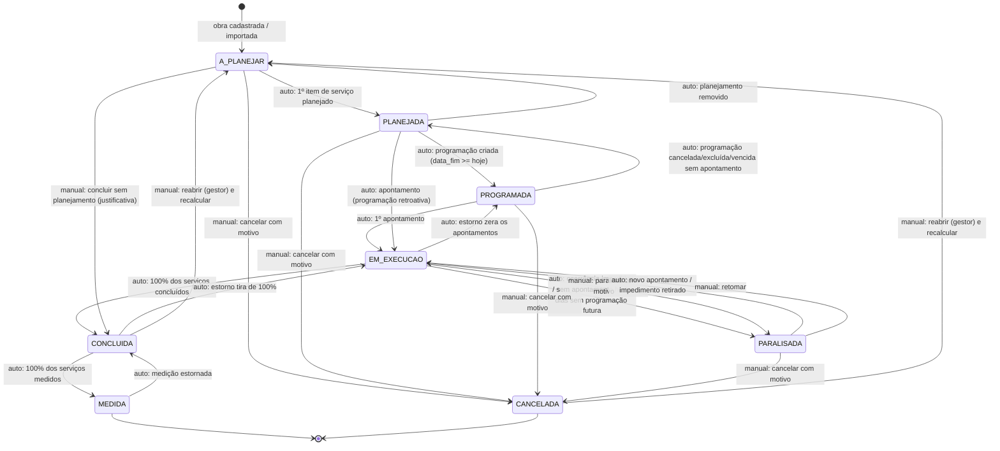

# Proposta: status das obras pelo que acontece no sistema

> Situação: proposta para validação do gestor. Nenhuma linha de código foi alterada.
> Base: código em `main` (28d2a0a5) e banco local `nexo-db` em 04/11/2026 (55 obras ativas).

## 1. Como funciona hoje

### 1.1 Cadastro de status

- Tabela `status_obras` (entidade `backend/.../obras/domain/StatusObra.java:19-58`): `nome` (único, gravado em maiúsculas), `ordem` e a flag `concluida`. Não existe código fixo nem enum: o status é um cadastro livre que o usuário pode criar, renomear (`StatusObra.atualizar`, linha 43) ou desativar (`StatusObraUseCases.desativar`, linha 82, sem verificar se há obras usando).
- Status cadastrados hoje:

| nome | ordem | concluida |
|---|---|---|
| PLANEJADA | 0 | não |
| EM EXECUÇÃO | 1 | não |
| PARALISADA | 2 | não |
| CONCLUÍDA | 3 | sim |
| CANCELADA | 4 | sim |

- `concluida = true` na prática quer dizer "encerrada": vale para CONCLUÍDA e CANCELADA.

### 1.2 Histórico

- Tabela `historico_status_obras` (entidade `HistoricoStatusObra.java:75-101`): obra, status anterior, status novo e observação. Quem e quando vêm da auditoria da `BaseEntity`. **Não há origem (manual ou automática) nem o evento que causou a troca.**
- Toda troca passa por `Obra.registrarTrocaStatus` (`Obra.java:471-477`), que ignora troca para o mesmo status (é idempotente).
- `Obra.informarStatusOperacional` (`Obra.java:363-379`) grava no histórico mesmo quando o status não muda, se vier uma observação nova.
- Hoje há 114 registros. O único texto automático é "Primeiro apontamento de execução." Os demais foram digitados ("Início da execução com a primeira programação em campo.", "Chuva contínua impediu o acesso...").

### 1.3 Onde o status muda

| # | Gatilho | Tipo | Onde |
|---|---|---|---|
| 1 | Cadastro da obra (status escolhido no formulário) | manual | `ObraUseCases.criar` → `new Obra(...)` grava o histórico inicial (`Obra.java:262`); `ObraUseCases.java:99-101` |
| 2 | Edição da obra (o formulário tem o campo Status) | manual | `ObraUseCases.atualizar` → `Obra.atualizarDados` (`Obra.java:299`) e `ObraUseCases.java:166-168` |
| 3 | `PATCH /v1/obras/{id}/status` (ação "Alterar status" da lista) | manual, sem observação | `ObraController.java:58-65` → `ObraUseCases.alterarStatus` (`ObraUseCases.java:192-197`) → `Obra.alterarStatus` (`Obra.java:304-312`) |
| 4 | `POST /v1/obras/{id}/status-operacional` (drawer "Alterar status" do detalhe) | manual, com observação | `CarteiraObraController.java:46` → `CarteiraObraUseCases.informarStatusOperacional` (`CarteiraObraUseCases.java:92-97`) |
| 5 | Importação da carteira (planilha) | manual em lote | obra nova com o status da coluna ou PLANEJADA (`ProcessarImportacaoCarteiraService.java:215-223`); obra existente **tem o status sobrescrito** pela planilha (`ProcessarImportacaoCarteiraService.java:182-189`) |
| 6 | Importação de obras (planilha antiga) | manual em lote | `ImportarObrasAsyncService.java:115-128` |
| 7 | Primeiro apontamento de execução da obra | **automático** | `ApontamentoExecucaoUseCases.java:70,81-83` chama `colocarObraEmExecucao` (`:131-141`), que procura o status pelo **nome** "EM EXECUÇÃO" e não mexe em obra encerrada |

Esse é o único gatilho automático. Nenhum dos eventos abaixo muda o status hoje:

- planejamento (kits e itens planejados) criado ou removido;
- programação criada, cancelada, excluída ou vencida (`ProgramacaoObraUseCases.java:105-160`);
- estorno de apontamento (`ApontamentoExecucaoUseCases.estornar`, `:90-95`), nem quando zera a execução;
- execução de 100% dos serviços (os itens viram CONCLUIDO, mas a obra não muda);
- pré-fechamento concluído ou reaberto (`PreFechamentoObraUseCases.java:94-114`, que só marca `levantamento_concluido_em` no planejamento);
- medição gerada ou estornada (`MedicaoObraUseCases.java:120-155`);
- ocorrência de turno que impede a execução (`turno_ocorrencias.impede_execucao`). Ela bloqueia o apontamento do dia, mas não paralisa a obra.

O evento `ItemExecutadoEvent` (`shared/domain/events/ItemExecutadoEvent.java`) é publicado a cada apontamento (`ApontamentoExecucaoUseCases.java:75`), mas nenhum listener o consome.

### 1.4 Regras e validações de transição

- **Não há validação de transição.** Pelos endpoints 3 e 4 qualquer status vai para qualquer outro: CANCELADA volta para EM EXECUÇÃO, CONCLUÍDA volta para PLANEJADA, sem motivo e sem permissão especial além de `obras:obra:write`.
- Ao ir para um status com `concluida`, a data de fim efetiva vira a informada ou a de hoje. Ao sair dele, a data é apagada (`Obra.java:307-311` e `:374-378`).
- A busca por nome ("EM EXECUÇÃO", "PLANEJADA") é frágil: se alguém renomear o status no cadastro, a regra automática para sem erro (`ApontamentoExecucaoUseCases.java:138` usa `ifPresent`).

### 1.5 Onde o frontend permite mudar status

- Lista de obras: botão "Alterar status" (`frontend/src/app/features/obras/lista/obras-lista.component.ts:279`, drawer em `:288`, envio em `:719`). Usa o endpoint 3, sem observação.
- Detalhe da obra: drawer "Alterar status" (`obra-detalhe.component.html:527`, `obra-detalhe.component.ts:672-703`). Usa o endpoint 4, com observação.
- Formulário de cadastro e edição: campo "Status" obrigatório (`obra-form.component.html:36`, `obra-form.component.ts:108,162,248`).
- Histórico: `GET /v1/obras/{id}/historico-status` (`CarteiraObraController.java:54`).
- O app de campo não muda o status diretamente. Ele muda só pelo apontamento (gatilho 7).

### 1.6 Efeitos colaterais do status

- **Programação:** obra com status `concluida` não pode ser programada (`ProgramacaoObraUseCases.java:107-109`) e sai da fila "obras a programar" (`ConsultarProgramacoesObra.java:134`).
- **Apontamento:** obra encerrada não volta para EM EXECUÇÃO (`ApontamentoExecucaoUseCases.java:135`). O apontamento em si não é bloqueado.
- **Medição e fechamento:** não dependem do status. A fila "obras a medir" usa só os apontamentos pendentes (`MedicaoObraUseCases.java:66-81`). Uma obra CANCELADA com execução continua aparecendo para medir.
- **Carteira, indicadores, exportação e Copiloto:** só exibem o nome do status (`CarteiraObraUseCases.java:173`, `ExportarObrasUseCase.java:197`, `ContextoObras.java:46`, camada semântica `V152`).
- **Faturamento:** não existe registro de faturamento por obra ou medição. A "planilha orçado x faturado" (`PlanilhaOrcadoFaturado.java`) é calculada a partir das medições.

### 1.7 Diagnóstico em uma frase

O status é um rótulo editável à mão por quatro caminhos sem regra de transição. O sistema já tem os fatos que definem a fase da obra (itens planejados, programações, apontamentos, ocorrências impeditivas, itens concluídos e medidos), mas só um deles, o primeiro apontamento, atualiza o status.

## 2. Máquina de estados proposta

### 2.1 Princípio

O status passa a ser **derivado dos fatos** por uma função única. Quem decide é o sistema. A pessoa só registra o que o sistema não consegue saber sozinho: cancelamento, paralisação por motivo externo, conclusão de obra sem planejamento e reabertura. Toda mudança fica no histórico com a origem e o evento que a causou.

### 2.2 Estados

| Código | Rótulo | Significado (fato que o define) | Encerrada? |
|---|---|---|---|
| `A_PLANEJAR` *(novo)* | A PLANEJAR | Obra na carteira sem item de serviço planejado | não |
| `PLANEJADA` | PLANEJADA | Tem itens de serviço planejados, mas nenhuma programação vigente e nenhum apontamento | não |
| `PROGRAMADA` *(novo)* | PROGRAMADA | Tem programação PROGRAMADA com `data_fim >= hoje` e ainda não tem apontamento | não |
| `EM_EXECUCAO` | EM EXECUÇÃO | Tem ao menos um apontamento ativo e os serviços ainda não chegaram a 100% | não |
| `PARALISADA` | PARALISADA | Já executou, mas está impedida (ocorrência impeditiva ou motivo manual) ou parada há N dias sem programação futura | não |
| `CONCLUIDA` | CONCLUÍDA | 100% dos itens de serviço estão CONCLUIDO ou MEDIDO, ou foi concluída manualmente com justificativa | sim |
| `MEDIDA` *(novo)* | MEDIDA | 100% dos itens de serviço estão MEDIDO (com medição GERADA) | sim |
| `CANCELADA` | CANCELADA | Cancelada manualmente com motivo | sim |
| `FATURADA` *(depende de decisão)* | FATURADA | Medições faturadas. Hoje não existe essa informação no sistema (ver Q8) | sim |

### 2.3 Diagrama



Observação: depois de "reabrir", o serviço recalcula na hora. A obra vai direto ao estado que os fatos indicam, não fica em A PLANEJAR se já tiver execução.

### 2.4 Regra de derivação (ordem de precedência)

A função `calcular(sinais, estadoAtual, fixacaoManual)` avalia de cima para baixo e para no primeiro que bater:

1. Fixação manual `CANCELADA` → **CANCELADA**.
2. Itens de serviço > 0 e todos MEDIDO → **MEDIDA**.
3. Itens de serviço > 0 e todos CONCLUIDO ou MEDIDO → **CONCLUÍDA**.
4. Fixação manual `CONCLUIDA` (obra sem planejamento) → **CONCLUÍDA**.
5. Fixação manual `PARALISADA` e nenhum apontamento depois dela → **PARALISADA**.
6. Tem apontamento e (ocorrência impeditiva ativa **ou** último apontamento há mais de N dias e nenhuma programação futura) → **PARALISADA**.
7. Tem apontamento → **EM EXECUÇÃO**.
8. Tem programação PROGRAMADA com `data_fim >= hoje` → **PROGRAMADA**.
9. Tem item de serviço planejado → **PLANEJADA**.
10. Senão → **A PLANEJAR**.

"Ocorrência impeditiva ativa" é uma `turno_ocorrencias.impede_execucao = true` da obra, sem APR concluída depois dela (mesma regra de `SituacaoLiberacao.avaliar`) e sem apontamento posterior. N é proposto como 15 dias (Q4).

### 2.5 Tabela de transições e gatilhos

| De | Para | Origem | Gatilho (evento) | Onde nasce o evento |
|---|---|---|---|---|
| A PLANEJAR | PLANEJADA | AUTOMATICA | `PLANEJAMENTO_ALTERADO` (kit aplicado ou item criado) | Use cases de planejamento e kits (`PlanejamentoObraUseCases`, `KitConstrutivoUseCases`, `ImportarKitsUseCase`) |
| PLANEJADA | A PLANEJAR | AUTOMATICA | `PLANEJAMENTO_ALTERADO` (último item removido) | idem |
| PLANEJADA | PROGRAMADA | AUTOMATICA | `PROGRAMACAO_CRIADA` / `PROGRAMACAO_REPROGRAMADA` | `ProgramacaoObraUseCases.programar/reprogramar` |
| PROGRAMADA | PLANEJADA | AUTOMATICA | `PROGRAMACAO_CANCELADA` / `PROGRAMACAO_EXCLUIDA` | `ProgramacaoObraUseCases.cancelar/excluir` |
| PROGRAMADA | PLANEJADA | AUTOMATICA | `PROGRAMACAO_VENCIDA` (data_fim < hoje sem apontamento) | job diário |
| PROGRAMADA ou PLANEJADA | EM EXECUÇÃO | AUTOMATICA | `APONTAMENTO_REGISTRADO` | `ApontamentoExecucaoUseCases.apontar` (já publica `ItemExecutadoEvent`) |
| EM EXECUÇÃO | PROGRAMADA ou PLANEJADA | AUTOMATICA | `APONTAMENTO_ESTORNADO` (zerou) | `ApontamentoExecucaoUseCases.estornar` |
| EM EXECUÇÃO | PARALISADA | AUTOMATICA | `OCORRENCIA_IMPEDITIVA` | registro de ocorrência do turno (`TurnoObraUseCases`) |
| EM EXECUÇÃO | PARALISADA | AUTOMATICA | `SEM_EXECUCAO_N_DIAS` | job diário |
| EM EXECUÇÃO | PARALISADA | MANUAL | `PARALISACAO_MANUAL` (motivo obrigatório) | endpoint de status |
| PARALISADA | EM EXECUÇÃO | AUTOMATICA | `APONTAMENTO_REGISTRADO` / `IMPEDIMENTO_RETIRADO` (APR concluída) | apontamento / APR |
| PARALISADA | EM EXECUÇÃO | MANUAL | `RETOMADA_MANUAL` | endpoint de status |
| EM EXECUÇÃO | CONCLUÍDA | AUTOMATICA | `EXECUCAO_100` (último item CONCLUIDO) | apontamento |
| CONCLUÍDA | EM EXECUÇÃO | AUTOMATICA | `APONTAMENTO_ESTORNADO` (saiu de 100%) | estorno |
| CONCLUÍDA | MEDIDA | AUTOMATICA | `MEDICAO_GERADA` (100% medido) | `MedicaoObraUseCases.gerar` |
| MEDIDA | CONCLUÍDA | AUTOMATICA | `MEDICAO_ESTORNADA` | `MedicaoObraUseCases.estornar` |
| A PLANEJAR | CONCLUÍDA | MANUAL | `CONCLUSAO_MANUAL` (justificativa, sem planejamento) | endpoint de status |
| qualquer não encerrado | CANCELADA | MANUAL | `CANCELAMENTO` (motivo obrigatório; bloqueado se houver medição gerada) | endpoint de status |
| CANCELADA ou CONCLUÍDA | (recalculado) | MANUAL | `REABERTURA` (perfil gestor, motivo) | endpoint de status |
| qualquer | (recalculado) | RECONCILIACAO | `RECONCILIACAO` | job diário e carga inicial |
| (criação) | A PLANEJAR | IMPORTACAO / MANUAL | `OBRA_CADASTRADA` | cadastro e importação |

Transições que continuam manuais: **cancelar**, **paralisar com motivo**, **retomar**, **concluir sem planejamento** e **reabrir**. Todas exigem texto. Cancelar e reabrir exigem uma permissão própria (proposta: `obras:status:encerrar`).

### 2.6 Reversões

- Programação cancelada, excluída ou vencida: a obra volta para PLANEJADA **só se** não houver outra programação vigente nem apontamento. Com apontamento, continua EM EXECUÇÃO.
- Estorno de apontamento recalcula: pode tirar a obra de CONCLUÍDA (volta EM EXECUÇÃO) ou de EM EXECUÇÃO (volta PROGRAMADA/PLANEJADA se zerou).
- Estorno de medição: MEDIDA volta para CONCLUÍDA.
- Status fixado à mão (CANCELADA, PARALISADA manual, CONCLUÍDA sem planejamento) **não** é desfeito por evento automático, com uma exceção: o apontamento posterior a uma paralisação manual retoma a obra (Q5).
- CANCELADA nunca é desfeita automaticamente.

### 2.7 Idempotência e concorrência

- O serviço calcula o estado a partir do banco, nunca do evento. Reprocessar o mesmo evento, ou receber dois eventos fora de ordem, gera o mesmo resultado.
- Se o estado calculado for igual ao atual, nada é gravado (mantém o comportamento de `registrarTrocaStatus`).
- `Obra` já tem `versao` (lock otimista da `BaseEntity`). Em conflito, o listener tenta de novo uma vez (o recálculo é barato e determinístico).
- O job diário roda a mesma função para todas as obras não encerradas. Ele é a rede de segurança para eventos perdidos.

### 2.8 Auditoria no histórico

Novas colunas em `historico_status_obras`:

| coluna | tipo | conteúdo |
|---|---|---|
| `origem` | varchar(20) | `MANUAL`, `AUTOMATICA`, `IMPORTACAO`, `RECONCILIACAO` |
| `evento` | varchar(40) | código da tabela 2.5 (ex.: `PROGRAMACAO_CRIADA`) |
| `id_referencia` | uuid | programação, apontamento, medição ou ocorrência que disparou |

A observação continua livre. Nas automáticas ela recebe um texto pronto, por exemplo "Programação #1234 criada para 10/11/2026." O histórico na tela mostra a origem ("Automático" ou o nome de quem mudou) e um link para a referência.

## 3. Como implementar no código atual

1. **Migração Flyway**
   - `status_obras`: coluna `codigo varchar(30) unique` (código estável da fase; o `nome` continua como rótulo editável). Preencher os 5 atuais. Inserir A PLANEJAR, PROGRAMADA e MEDIDA (e FATURADA se Q8 = sim). Recalcular `ordem`.
   - `historico_status_obras`: `origem`, `evento`, `id_referencia` (registros antigos: `origem = 'MANUAL'`, `evento = 'LEGADO'`).
   - `obras`: `status_fixado varchar(30) null` (CANCELADA, PARALISADA, CONCLUIDA quando a pessoa fixou) e `status_fixado_em timestamptz`.
2. **Domínio (`obras.domain`)**
   - `enum FaseObra` com os códigos.
   - `record SinaisObra(...)`: itens de serviço, concluídos, medidos, programação vigente, apontamentos, último apontamento, impedimento ativo.
   - `MaquinaStatusObra`: função pura `FaseObra calcular(SinaisObra, FaseObra atual, FaseObra fixada, LocalDate hoje)` e `Set<FaseObra> transicoesManuais(FaseObra atual)`. Testável sem Spring (teste de tabela cobrindo 2.4 e 2.5).
   - `Obra.aplicarStatus(StatusObra, OrigemStatus, String evento, UUID ref, String obs)` substitui `alterarStatus` e `informarStatusOperacional`. O construtor passa a gravar o histórico inicial com origem.
3. **Serviço central (`obras.application`)**: `TransicaoStatusObraService`
   - `reavaliar(UUID idObra, String evento, UUID ref)`: lê os sinais (consulta agregada única, igual à do apêndice), calcula e aplica se mudou.
   - `transicionarManual(UUID idObra, FaseObra destino, String motivo, LocalDate dataFim)`: valida com `transicoesManuais`, grava `status_fixado` e depois chama `reavaliar`.
   - Resolve `StatusObra` por `codigo`, não por nome.
4. **Eventos**
   - Dentro do módulo `obras` (programação, apontamento, planejamento, medição): publicar records internos (`ProgramacaoAlteradaEvent`, `ApontamentoEstornadoEvent`, `MedicaoAlteradaEvent`, `PlanejamentoAlteradoEvent`) e reaproveitar o `ItemExecutadoEvent` que já existe. Um único `ReavaliacaoStatusObraListener` com `@TransactionalEventListener(phase = BEFORE_COMMIT)` chama `reavaliar` na mesma transação, para a tela já voltar com o status certo. Isso substitui `colocarObraEmExecucao` (`ApontamentoExecucaoUseCases.java:131-141`).
   - Eventos de outro módulo (ex.: ocorrência impeditiva, se ficar no módulo `execucao`): `@ApplicationModuleListener` (assíncrono, depois do commit, com registro de publicação do `spring-modulith-starter-jpa`, igual ao `TurnoAbertoListener`).
5. **Job de reconciliação**: `ReconciliacaoStatusObrasScheduler` (padrão do `EncerramentoAutomaticoTurnosScheduler`), diário de madrugada. Trata as regras de tempo (programação vencida, N dias sem execução) e corrige divergências com origem `RECONCILIACAO`. Mais um endpoint administrativo `POST /v1/obras/status/reconciliar?simular=true` que devolve a lista "de → para" sem gravar. Esse endpoint faz a carga inicial.
6. **Endpoints e telas**
   - Unificar `PATCH /{id}/status` e `POST /{id}/status-operacional` num só (`POST /{id}/status-operacional` com `acao`: PARALISAR, RETOMAR, CANCELAR, CONCLUIR, REABRIR). O `PATCH` fica deprecado.
   - Tirar o campo Status do formulário de edição. No cadastro, a obra nasce A PLANEJAR.
   - Importação de carteira: em obra existente, aceitar só CANCELADA e ignorar o resto com aviso (Q10).
   - Drawer "Alterar status" (lista e detalhe) mostra só as ações manuais permitidas e o histórico com a origem.
   - Cadastro de status: permitir só renomear o rótulo e reordenar. Criar e desativar status ficam bloqueados (Q14).
7. **Medição e programação**: manter o bloqueio de programação em obra encerrada (MEDIDA e CANCELADA entram como encerradas). Passar a bloquear medição de obra CANCELADA.

Arquivos que mudariam: `Obra.java`, `StatusObra.java`, `HistoricoStatusObra.java`, `ObraUseCases.java`, `CarteiraObraUseCases.java`, `ApontamentoExecucaoUseCases.java`, `ProgramacaoObraUseCases.java`, `MedicaoObraUseCases.java`, `PlanejamentoObraUseCases.java`, `ProcessarImportacaoCarteiraService.java`, `ImportarObrasAsyncService.java`, controllers `ObraController` e `CarteiraObraController`. No frontend: `obras-lista.component.ts`, `obra-detalhe.component.*`, `obra-form.component.*` e `obras.service.ts`. A camada semântica do Copiloto (`V152`) precisa de revisão para os novos nomes.

## 4. Impacto nas 55 obras atuais

Simulação no `nexo-db` (SQL no apêndice), com N = 15 dias e status fixado à mão preservado para CANCELADA e PARALISADA:

| Status atual | Status proposto | Obras |
|---|---|---|
| CANCELADA | CANCELADA | 4 |
| CONCLUÍDA | CONCLUÍDA | 4 |
| CONCLUÍDA | **MEDIDA** | **5** |
| EM EXECUÇÃO | EM EXECUÇÃO | 16 |
| PARALISADA | PARALISADA | 5 |
| PLANEJADA | **A PLANEJAR** | **5** |
| PLANEJADA | PLANEJADA | 11 |
| PLANEJADA | **PROGRAMADA** | **5** |
| **Total que muda** | | **15 de 55** |

As obras que mudam:

- PLANEJADA → PROGRAMADA (têm programação vigente e nenhum apontamento): 1027377, 1029302, 1031451, 1034629, 1036239.
- PLANEJADA → A PLANEJAR (nenhum item planejado): 1029526, 1032928, 1034762, 1035882, 1037359.
- CONCLUÍDA → MEDIDA (100% dos serviços medidos): 1026348, 1027244, 1030331, 1030779, 1033285.

Por cenário de decisão:

| Cenário | Obras que mudam |
|---|---|
| Proposta completa (A PLANEJAR + PROGRAMADA + MEDIDA) | 15 |
| Sem A PLANEJAR | 10 |
| Sem MEDIDA | 10 |
| Só PROGRAMADA como estado novo | 5 |
| Só os 5 estados atuais | 0 |

Os 5 estados atuais já estão coerentes com as regras automáticas. Todas as EM EXECUÇÃO têm apontamento. As 5 PARALISADAS também ficariam paralisadas pela regra automática: 3 por ocorrência impeditiva nos últimos 15 dias e 2 por mais de 15 dias sem apontamento e sem programação futura. As 9 CONCLUÍDAS estão com 100% dos serviços concluídos e pré-fechamento feito.

Ponto de atenção: 1026572 (último apontamento em 26/09) e 1033509 (25/09) estão há mais de 15 dias sem execução, mas continuam EM EXECUÇÃO porque têm programação futura. Se a regra de inatividade ignorar a programação futura, essas duas virariam PARALISADA.

## 5. Perguntas para o gestor

| # | Pergunta | Opções | Recomendada |
|---|---|---|---|
| Q1 | Criar o estado **A PLANEJAR** para obra sem planejamento? | a) sim; b) não, PLANEJADA continua sendo o inicial | **a** (separa carteira crua de obra pronta para programar; afeta 5 obras) |
| Q2 | Criar o estado **PROGRAMADA**? | a) sim; b) não, programação é só indicador | **a** (afeta 5 obras) |
| Q3 | Programação vencida sem nenhum apontamento devolve a obra para PLANEJADA? | a) sim, pelo job diário; b) não, fica PROGRAMADA até cancelarem | **a** |
| Q4 | Paralisação automática por inatividade: depois de quantos dias sem apontamento, e só sem programação futura? | a) 15 dias, só sem programação futura; b) 7 dias; c) não paralisar por inatividade, só por ocorrência | **a** |
| Q5 | Obra paralisada à mão: um novo apontamento retoma sozinho? | a) sim, registra "retomada automática"; b) não, só retomada manual (apontamento bloqueado ou aceito sem mudar status) | **a** |
| Q6 | O que conclui a obra? | a) 100% dos serviços executados; b) pré-fechamento concluído; c) os dois; d) programação marcada "finaliza obra" executada | **a** (o pré-fechamento vira pendência visível, não bloqueio) |
| Q7 | Pode concluir à mão uma obra sem planejamento (corretiva ou legado)? | a) sim, com justificativa; b) não | **a** |
| Q8 | Estados de medição: criar **MEDIDA** (100% medido)? E **FATURADA**? | a) MEDIDA agora e FATURADA depois, quando o financeiro registrar o faturamento por medição; b) as duas agora (FATURADA manual); c) nenhuma, medição é só indicador | **a** (MEDIDA afeta 5 obras) |
| Q9 | Medição parcial muda o status? | a) não, a obra continua EM EXECUÇÃO e a medição aparece como indicador; b) criar "PARCIALMENTE MEDIDA" | **a** |
| Q10 | A importação da carteira pode mudar o status de obra existente? | a) só para CANCELADA, o resto é ignorado com aviso; b) não muda nada; c) continua sobrescrevendo | **a** |
| Q11 | Tirar o campo Status do formulário de edição da obra? | a) sim, status só pelas ações; b) manter | **a** |
| Q12 | Quem cancela e reabre (CANCELADA/CONCLUÍDA → aberta)? | a) permissão própria de gestor, com motivo; b) qualquer um com `obras:obra:write` | **a** |
| Q13 | Pode cancelar obra que já tem medição gerada? | a) não, precisa estornar antes; b) sim | **a** |
| Q14 | O cadastro de status passa a ser fixo (só renomear e reordenar)? | a) sim; b) continua livre, mas status sem código não entra na regra | **a** |
| Q15 | Carga inicial: aplicar a reconciliação nas 55 obras de uma vez, registrando "RECONCILIACAO" no histórico? | a) sim, depois de revisar a simulação; b) só daqui para frente | **a** |

## Apêndice: SQL da simulação

```sql
create temp view sinais as
select o.id, o.numero, o.tipo_obra, s.nome status_atual,
  (select count(*) from itens_planejados i join kits_aplicados k on k.id=i.id_kit_aplicado
    where k.id_obra=o.id and i.ativo and k.ativo and i.tipo='SERVICO') itens_serv,
  (select count(*) from itens_planejados i join kits_aplicados k on k.id=i.id_kit_aplicado
    where k.id_obra=o.id and i.ativo and k.ativo and i.tipo='SERVICO' and i.status in ('CONCLUIDO','MEDIDO')) itens_concl,
  (select count(*) from itens_planejados i join kits_aplicados k on k.id=i.id_kit_aplicado
    where k.id_obra=o.id and i.ativo and k.ativo and i.tipo='SERVICO' and i.status='MEDIDO') itens_medidos,
  (select count(*) from programacoes p where p.id_obra=o.id and p.ativo and p.status='PROGRAMADA'
    and p.data_fim>=current_date) prog_futuras,
  (select count(*) from apontamentos_execucao a where a.id_obra=o.id and a.ativo) apont,
  (select max(a.data) from apontamentos_execucao a where a.id_obra=o.id and a.ativo) ult_apont,
  (select count(*) from turno_ocorrencias t join turnos tu on tu.id=t.id_turno
    where t.id_obra=o.id and t.ativo and t.impede_execucao and tu.data_inicio > now()-interval '15 days') impedimentos_15d
from obras o join status_obras s on s.id=o.id_status_obra where o.ativo;

select status_atual, proposto, count(*) from (
  select *, case
    when status_atual='CANCELADA' then 'CANCELADA'
    when itens_serv>0 and itens_medidos=itens_serv then 'MEDIDA'
    when itens_serv>0 and itens_concl=itens_serv then 'CONCLUÍDA'
    when status_atual='CONCLUÍDA' and itens_serv=0 then 'CONCLUÍDA'
    when status_atual='PARALISADA' then 'PARALISADA'
    when apont>0 and impedimentos_15d>0 then 'PARALISADA'
    when apont>0 and ult_apont < current_date-15 and prog_futuras=0 then 'PARALISADA'
    when apont>0 then 'EM EXECUÇÃO'
    when prog_futuras>0 then 'PROGRAMADA'
    when itens_serv>0 then 'PLANEJADA'
    else 'A PLANEJAR' end proposto
  from sinais) x
group by 1,2 order by 1,2;
```

Observação: a simulação aproxima "impedimento ativo" como ocorrência impeditiva nos últimos 15 dias. A regra final usa a mesma lógica de liberação do apontamento (APR concluída depois da ocorrência).

## Decisões do usuário (04/11/2026)

- **PARALISADA nunca é automática.** Só entra de forma manual, com motivo. Não paralisar por inatividade nem por ocorrência impeditiva (revisa as perguntas 4 e 5).
- **O pré-fechamento é feito antes de a obra iniciar** (avaliação das condições da obra). Não é obrigatório e não bloqueia programação, execução nem conclusão. Quando não tiver sido feito, aparece como pendência ou recomendação (revisa a pergunta 6).
- As demais perguntas (1–3 e 7–15) foram aprovadas com a opção recomendada. A implementação está aprovada, mas só começa quando o usuário der a ordem.
